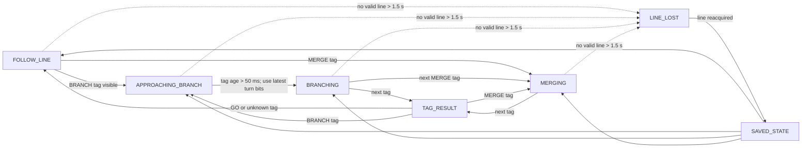

# E13/E14 State Behavior

There are two independent state values:

- **Controller state** says which control mode or safety condition is active.
- **Line-follower state** says what navigation behavior AUTO mode should use.

E13 implements AUTO/MANUAL, LOW_BATT, STOPPED, FOLLOW_LINE, and LINE_LOST.
NFC-driven branch/merge navigation is the planned E14 extension.

## 1. Controller state

### State meanings

| State | Meaning |
| --- | --- |
| `AUTO` | Line-follower control determines wheel targets. |
| `MANUAL` | World State direction/turn bits directly determine wheel targets. |
| `LOW_BATT` | Battery safety override; both wheel targets are zero. |
| `STOPPED` | No movement requested, including boot/setup and serial stop. |

### Transitions

| Current state | Event | Next state | Result |
| --- | --- | --- | --- |
| Boot | Reset begins | `STOPPED` | Motors remain stopped during setup. |
| `STOPPED` | Setup complete and optional default-start setting enabled | `AUTO` | Set the run target to the configurable default (100 mm/s initially). |
| Any state except `LOW_BATT` | Valid World State, `auto=1` | `AUTO` | Select AUTO. The `forward` bit sets the run target or zero; it does not change AUTO state. |
| Any state except `LOW_BATT` | Valid World State, `auto=0` | `MANUAL` | Select MANUAL and apply the direction/turn bits. |
| `AUTO` or `MANUAL` | Filtered battery < 9.5 V continuously for 5 s | `LOW_BATT` | Stop both motors. |
| `STOPPED` | Filtered battery < 9.5 V continuously for 5 s | `LOW_BATT` | Remain stopped; report the battery safety state. |
| `LOW_BATT` | Filtered battery > 10.0 V continuously for 5 s | `AUTO` | Clear the safety override and return to AUTO. |
| Any state except `LOW_BATT` | Serial `S<speed>` | `AUTO` | Set the AUTO run target to the supplied speed. |
| Any state except `LOW_BATT` | Serial bare `S` or `STOP` | `STOPPED` | Set the run target to zero and stop both motors. |
| `AUTO` or `MANUAL` controlled by World State | No valid World State for 500 ms | Keep current mode | Set speed targets and retained turn indicators to zero; a later World State can command movement again. |

The mode bit is a value, not a toggle: every valid World State with `auto=1`
selects AUTO; `auto=0` selects MANUAL. LOW_BATT overrides World State and
serial mode/speed commands until its recovery condition is met. On recovery it
always returns to AUTO with a zero speed target. A subsequent valid World State
or serial speed command is needed to request motion.

The 500 ms timeout is a car-side safety rule, separate from the modem's
1,000 ms mailbox expiry. It applies only while the current command source is
World State; a serial `S<speed>` command is not expired by this timer.

### Movement behavior by mode

| Mode | World State command | Result |
| --- | --- | --- |
| AUTO | `forward=1` | Set configurable run target (100 mm/s initially). |
| AUTO | `forward=0` | Set run target to 0 mm/s; controller remains AUTO. |
| AUTO | `backward` bit | Ignored. |
| MANUAL | Forward only | Both wheels target +50 mm/s. |
| MANUAL | Backward only | Both wheels target -50 mm/s. |
| MANUAL | Forward and backward together | Conflicting request; stop both wheels. |
| MANUAL | Direction plus one turn indicator | Gentle differential turn: outer wheel 50 mm/s, inner wheel 10 mm/s, with signs following the requested direction. |
| MANUAL | Turn indicator without a direction bit | Zero-radius turn: wheels run in opposite directions at 50 mm/s. |
| MANUAL | Neither direction nor turn | Stop both wheels. |

For turns, right takes precedence if both indicators are set. The gentle-turn
steering magnitude is 0.8. Serial `S<speed>` always switches to AUTO; `P`,
`L`, and `R` are not part of E13.

## 2. Line-follower state

### State meanings

| State | Meaning | Scope |
| --- | --- | --- |
| `FOLLOW_LINE` | Normal line tracking. | E13 |
| `LINE_LOST` | No valid line after the recovery grace period; previous navigation state is saved. | E13 |
| `APPROACHING_BRANCH` | A BRANCH tag is currently being seen. | E14 |
| `BRANCHING_CENTER` | Continue through a branch following the center. | E14 |
| `BRANCHING_LEFT` | Continue through a branch following the left edge. | E14 |
| `BRANCHING_RIGHT` | Continue through a branch following the right edge. | E14 |
| `MERGING_FROM_LEFT` | Navigation state selected by a MERGE_LEFT tag. | E14 |
| `MERGING_FROM_RIGHT` | Navigation state selected by a MERGE_RIGHT tag. | E14 |
| `MERGING_FROM_CENTER` | Navigation state selected by a MERGE_CENTER tag. | E14 |

### Compact transition overview

`BRANCHING`, `MERGING`, `TAG_RESULT`, and `SAVED_STATE` in the overview are
groups/placeholders, not additional transmitted state values. The transition
tables below define their exact meanings.

### NFC tag transitions (planned E14 behavior)

| Current line-follower state | New tag event | Next state |
| --- | --- | --- |
| `FOLLOW_LINE` | GO or unknown UID | `FOLLOW_LINE` |
| `FOLLOW_LINE` | Any BRANCH subtype | `APPROACHING_BRANCH` while visible |
| `FOLLOW_LINE` | MERGE_LEFT / MERGE_RIGHT / MERGE_CENTER | Matching `MERGING_FROM_*` state |
| `APPROACHING_BRANCH` | Same branch tag remains visible | Remain `APPROACHING_BRANCH` while age is <= 50 ms. |
| `APPROACHING_BRANCH` | Branch tag age exceeds 50 ms | Select `BRANCHING_LEFT`, `BRANCHING_RIGHT`, or `BRANCHING_CENTER` using the latest turn indicators; right wins if both are set, neither means center. |
| Any `BRANCHING_*` state | GO or unknown UID | `FOLLOW_LINE` |
| Any `BRANCHING_*` state | Any BRANCH subtype | `APPROACHING_BRANCH` |
| Any `BRANCHING_*` state | Any MERGE type | Matching `MERGING_FROM_*` state |
| Any `MERGING_FROM_*` state | GO or unknown UID | `FOLLOW_LINE` |
| Any `MERGING_FROM_*` state | Any BRANCH subtype | `APPROACHING_BRANCH` |
| Any `MERGING_FROM_*` state | Any MERGE type | Matching `MERGING_FROM_*` state |

All BRANCH subtypes (`BRANCH_LEFT`, `BRANCH_RIGHT`, `BRANCH_LR`, and
`BRANCH_THREEWAY`) use the same generic transition in this design. The UID to
tag-type lookup table is deferred to E14; until it is implemented, unknown
UIDs are classified as GO. A tag is considered visible while its age since
the last successful read is at most 50 ms. A later successful read after the
age exceeds 50 ms is a new tag event.

### Line loss and recovery

Line loss applies uniformly to whichever navigation state was selected:

| Event | Line-follower state result | Motor effect |
| --- | --- | --- |
| Invalid/no-line sensor reading, but within E12's 1.5 s grace period | Keep current state and steer using the previous valid sensor pattern. | AUTO continues its previous line-follow targets. |
| No valid line for > 1.5 s | Save the current state and report `LINE_LOST`. | AUTO wheel targets become zero. |
| Valid line reacquired | Restore the saved state, whether it was FOLLOW_LINE, APPROACHING_BRANCH, BRANCHING_*, or MERGING_FROM_*. | If controller is AUTO, resume line following; if MANUAL, continue direct manual control. |

MANUAL does not require a detected line and remains available to reposition
the car while `line_follower_state` reports `LINE_LOST`.

## Implementation boundary and verification

E13 implements the controller-state transitions, AUTO/MANUAL movement behavior,
and FOLLOW_LINE/LINE_LOST handling. E14 implements the UID lookup and
NFC-driven branch/merge transitions in the tables above. The full planned
line-state table is included now to review behavior without implying that
E13 already supports the E14 navigation states.

Verify E13 with World State mode changes, AUTO forward/stop targets, the
500 ms World State timeout and recovery, manual
direction/turn combinations, serial AUTO/STOP commands, LOW_BATT entry and
recovery dwell times, and line-loss grace/recovery. Verify the NFC transition
table on E14 with GO, all branch and merge types, unknown UIDs, the 50 ms
visibility rule, and state restoration after line loss.
